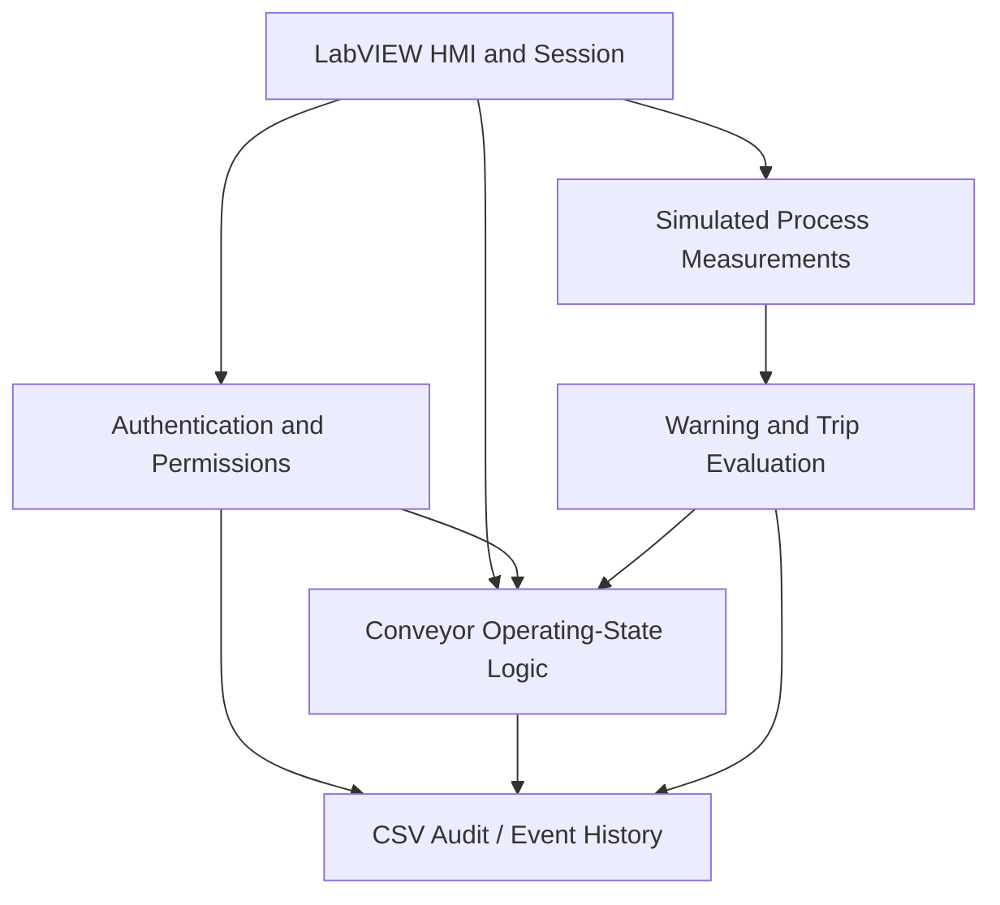

# Industrial Operator Authentication, Machine Control & Monitoring System

**NI LabVIEW 2020 | Industrial Automation | Control Systems | HMI Development**

[**Full Notion project case study**](https://guttural-galliform-d52.notion.site/Industrial-Operator-Authentication-Machine-Control-Monitoring-System-41e920417b9d808ebb63f9981f96676f) · [Functional test results](docs/verification-and-test-results.md) · [System architecture](docs/system-architecture.md) · [Figures and screenshot guide](docs/screenshots.md)

## Project overview

A LabVIEW-based **industrial conveyor control simulation** combining operator login, role-based authorization, simulated conveyor motor control, process monitoring, alarm handling, and timestamped CSV event logging. The project demonstrates concepts applicable to **PLC programming, machine sequencing and industrial HMI engineering** without claiming physical PLC implementation.

> **Scope:** Software simulation only — no physical PLC, motor, drive, field wiring, or real sensors were integrated. It is not a safety-rated industrial control system.

## Modules

| HMI module | Implemented / documented functions |
| --- | --- |
| Operator Login | Authentication, Operator/Maintenance/Administrator permissions, failed-login counter, 30-second lockout after 3 failures, session timeout |
| Machine Control | Conveyor START/STOP, RPM, state indicators, simulated acceleration/deceleration, run permissives and trip restrictions |
| Sensor Monitoring | Simulated RPM, temperature and motor current, sensor validity, warning/trip indication |
| Alarm Management | Alarm register, severity, acknowledgment, state, timestamps, fault reset |
| Event History | Timestamped authentication, operation and alarm-related CSV audit records |
| Administration / Settings | Configurable warning/trip values, start permissives, fault injection, demonstration number generator |

## Configured limits

| Simulated measurement | Warning | Trip |
| --- | ---: | ---: |
| Motor temperature | 75°C | 90°C |
| Motor current | 6 A | 9 A |

The thresholds above were visible in the submitted LabVIEW Front Panel screenshots.

## Observed operational tests

| Scenario | Screenshot-based observation |
| --- | --- |
| Administrator authentication | Login successful and permission indicators enabled |
| Lockout | 3 failed attempts; 30-second lockout, 22 seconds remaining at capture |
| Motor startup | RUNNING, **1,143.6 RPM**, **32.524°C**, **5.2572 A**, “Start accepted” |
| Separate monitoring observation | **1,500 RPM**, **70°C**, **4.5 A**, sensor quality GOOD, alarms inactive |
| Thermal trip | **100°C** exceeds 90°C setpoint → FAULT, **0 RPM**, **0 A** |
| Latched/retained fault | At **83.641°C** the machine still showed FAULT, 0 RPM, 0 A |
| Alarm register | A102 overtemperature TRIP / ACTIVE / UNACKNOWLEDGED; A107 lockout WARNING / CLEARED / UNACKNOWLEDGED |
| Event history | INITIALIZATION → IDLE, Administrator LOGIN_SUCCESS, IDLE → READY, READY → RUNNING |

The normal-running and normal-monitoring numbers are from **different screenshots**, not one simultaneous measurement.

## Functional acceptance

**16 / 16 checks reported PASS** by the project author, including application startup, login/roles, motor operation, speed, current/temperature, overtemperature, overload, sensor failure, alarm acknowledgment/reset, logs, timeout, repeated operation and project reopening.

These are manual author-reported results, **not** independently reproduced or safety-certified tests. See the [complete checklist and limitations](docs/verification-and-test-results.md).

## Conceptual architecture

*Conceptual functional diagram, not a recovered LabVIEW Block Diagram.*

## Documentation

- [System architecture and operation](docs/system-architecture.md)
- [Roles, login, and security-limit behavior](docs/authentication-and-access-control.md)
- [Conveyor operation and state transitions](docs/machine-control.md)
- [Monitoring limits, fault behavior and alarms](docs/monitoring-alarms-and-recovery.md)
- [Detailed 16-test checklist and observed evidence](docs/verification-and-test-results.md)
- [Real screenshot names and portfolio captions](docs/screenshots.md)
- [Source package and reproduction checklist](docs/source-and-reproduction.md)
- [User guide (README to be uploaded)](user-guide/)

## Files

The original **LabVIEW VIs/ZIP**, **10-page engineering report PDF**, and **Front Panel JPG/PNG screenshots** are not hosted here yet. The source file/package has not been supplied for independent examination. This repository currently contains the documented project and indices; add the actual binary assets before claiming it contains the program or screenshots.

[**View the Notion project and its figures**](https://guttural-galliform-d52.notion.site/Industrial-Operator-Authentication-Machine-Control-Monitoring-System-41e920417b9d808ebb63f9981f96676f)

*Academic / self-developed engineering portfolio project · Completed, with final functional testing reported passed.*
